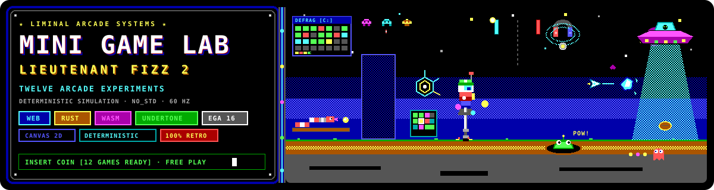

# Mini Game Lab

<p align="center">
  
</p>

<p align="center">
  
  
  
  
</p>

*Mini Game Lab* is a suite of bite-sized retro arcade proofs of concept built on the [Lieutenant Fizz 2](https://github.com/ScottMorris/lieutenant-fizz-2) simulation engine. Each mini-game isolates and explores distinct mechanics—continuous ballistic pogo jumping, vertical falling-block puzzles, fixed-screen wave shooting, grid reflex action, maze navigation, 360° inertia flight, and pressurized paddle battles—powered by deterministic fixed-tick Rust physics and presented in crisp retro Canvas 2D with sound from [Undertone](https://github.com/liminal-hq/undertone).

The lab is organised as a multi-game monorepo featuring a central Hub launcher and six independent game environments, with automated deployment to GitHub Pages.

## The Games

```text
       ┌─────────────────────────────────────────────────────────────┐
       │                     MINI GAME LAB HUB                       │
       └──────┬──────────┬──────────┬──────────┬──────────┬──────────┘
              │          │          │          │          │          │
              ▼          ▼          ▼          ▼          ▼          ▼
           [FIZZ]     [COCOA]    [POGO]     [GLOOP]    [GUMDROP]  [CRYSTAL]
          INVADERS     DROP      PANIC      SLUGGER     PAC-MAN    DEFENDER
```

### 1. Fizz Invaders
A Space Invaders–style arcade shooter. Waves of descending Zarg starships sweep horizontally across the screen while Ben Blaze manoeuvres along the bottom edge, firing cream soda fizz bubbles upward. Destructible chocolate blocks provide temporary shields against incoming Zarg plasma drops. Built on `fizz-sim` rules and `fizz-view` scene placement. Detailed design in [`docs/specs/FIZZ_INVADERS.md`](docs/specs/FIZZ_INVADERS.md).

### 2. Cocoa Drop
A falling-block match-3 puzzle game. Pairs of coloured crystals and chocolate blocks drop down a vertical well. Players steer and drop clusters to form matching lines of three or more before the cocoa rises to the top of the board. State tracking and column resolution run under deterministic simulation steps. Detailed design in [`docs/specs/COCOA_DROP.md`](docs/specs/COCOA_DROP.md).

### 3. Pogo Panic
A high-altitude vertical platformer in the vein of Doodle Jump. Ben bounces continuously upwards using the continuous momentum physics of `fizz-phys`. Steer left and right to land on moving platforms and crumbly chocolate ledges while avoiding swooping crystal bats and phantom drones. Detailed design in [`docs/specs/POGO_PANIC.md`](docs/specs/POGO_PANIC.md).

### 4. Gloop Slugger
A fast-paced reflex test set in the Cocoa Fields. Gloop slugs pop out of a 3×3 grid of impact craters for brief windows of time. Players must react swiftly to blast each slug before it ducks back underground, while watching out for dangerous Zarg phantoms whose false appearances penalise your score. Detailed design in [`docs/specs/GLOOP_SLUGGER.md`](docs/specs/GLOOP_SLUGGER.md).

### 5. Gumdrop Pac-Man
A top-down maze chaser set within Mildred’s Citadel. Guide Ben through geometric corridors to devour Cheezies, fudge cookies, and gumdrops while evading four patrolling Zarg phantoms. Collect rare Cream Soda cans to supercharge Ben, allowing him to stun and bypass phantoms temporarily. Detailed design in [`docs/specs/GUMDROP_PACMAN.md`](docs/specs/GUMDROP_PACMAN.md).

### 6. Crystal Defender
An omnidirectional 360° survival shooter in the style of Asteroids. Floating weightless in the Crystal Caves, Ben rotates and applies thruster bursts to navigate treacherous zero-gravity caverns, firing bubbles to shatter incoming bats and crystalline boulders into smaller fragments. Detailed design in [`docs/specs/CRYSTAL_DEFENDER.md`](docs/specs/CRYSTAL_DEFENDER.md).

### 7. Fizz-Pong: Carbonation War
A pressurized soda-tank paddle battle paying tribute to Commander Keen’s wristwatch Paddle War. Ben slides along the bottom baseline to return a lively plasma orb against a tracking Zarg drone. Rising carbonation bubble currents deflect ball trajectories across the fluid, and sustained 5-hit rallies spawn Fizz Bubbles for multiball chaos. Detailed design in [`docs/specs/FIZZ_PONG.md`](docs/specs/FIZZ_PONG.md).

## Engine Architecture

Mini Game Lab reuses the layered architecture and `no_std` determinism discipline established by [Lieutenant Fizz 2](https://github.com/ScottMorris/lieutenant-fizz-2):

- **Rules Layer (`fizz-sim`):** Pure `no_std` simulation foundation providing a 60 Hz tick clock (`TICK_HZ`, `Tick`), unified button latching (`Buttons`, `InputFrame`), and 64-bit state hashing (`StateHash`) for deterministic verification.
- **Physics Layer (`fizz-phys`):** Owned continuous physics toolkit derived from Fizz 1's model—AABB body collision resolution (`Body`), moving platforms (`Platform`), tile maps (`TileMap`), deterministic pseudorandom numbers (`Rng`), and nearest-first light management (`Lights`).
- **Scene Layer (`fizz-view`):** Platform-neutral coordinates, camera tracking (`Camera`), sprite rects (`SpriteRect`), and packed instance buffers.
- **Game Crates (`crates/*`):** Discrete Rust simulation modules for each mini-game, compiling natively for test harnesses and to `wasm32-unknown-unknown` for browser execution.
- **Web Presenters (`games/*`):** High-efficiency Canvas 2D viewports with Vite bundling and Undertone audio synthesis.

## Getting Started

### Prerequisites

You will need [Bun](https://bun.sh) (v1.3+) and the pinned [Rust](https://rustup.rs) toolchain with the WebAssembly target installed:

```bash
rustup target add wasm32-unknown-unknown
```

### Installation

Install JavaScript dependencies across the workspace:

```bash
bun install --frozen-lockfile
```

### Local Development

Launch the development server for the Hub:

```bash
bun run dev
```

Navigate to `http://localhost:5173` in your browser to launch any of the six mini-games. Each game includes a dedicated return button to navigate back to the main Hub at any time.

### Building for Production

Compile all Rust crates and assemble the complete static distribution:

```bash
bun run build
```

The output is bundled into `dist/`, with the Hub at the root and each mini-game situated under `dist/games/<game>/`. You can preview the production bundle locally:

```bash
bunx serve dist
```

### Running Tests and Quality Checks

```bash
# Run all unit tests across the Rust workspace
cargo test --workspace

# Check formatting and Clippy lints
cargo fmt --all -- --check
cargo clippy --workspace --all-targets -- -D warnings

# Run Web lints, Prettier formatting and TypeScript typechecks
bun run validate
```

## Continuous Integration

CI/CD is broken down into granular, independent parallel jobs modeled after Fizz Studio:

| Job | Description | Command |
|---|---|---|
| **Rust format** | Verifies Rust code style against `rustfmt` | `cargo fmt --all -- --check` |
| **Rust Clippy** | Strict lint checks with zero warnings tolerated | `cargo clippy --workspace --all-targets -- -D warnings` |
| **Rust tests** | Full test suite across all simulation crates | `cargo test --workspace` |
| **Prettier format** | Validates code style across Web codebases | `bunx prettier --check .` |
| **ESLint** | TypeScript and JavaScript lint verification | `bun run lint` |
| **TypeScript type check** | Static type verification across Hub and all games | `bun run typecheck` |
| **WASM build check** | Validates `wasm32-unknown-unknown` compilation | `cargo check --workspace --target wasm32-unknown-unknown` |
| **Web site build** | Full production build of Hub and games into `dist/` | `bun run build` |

Pushes to `main` automatically deploy the compiled `dist/` directory to GitHub Pages.

## Licence and Authorship

- **Author:** Scott Morris (`scott.moris@gmail.com`)
- **Co-author:** Jules (`google-labs-jules[bot]`)
- **Licence:** Dual-licensed under [Apache-2.0](LICENSE-APACHE) OR [MIT](LICENSE-MIT).
